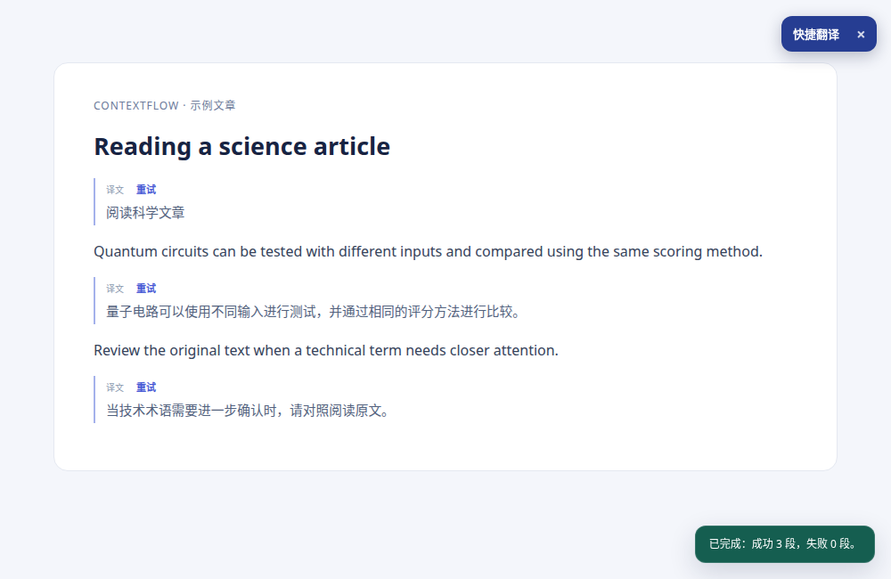

# ContextFlow Translate 0.1.0

**中文用户：** [查看图文使用教程](docs/图文使用教程.md) · [下载最新源码](https://github.com/muran169633/contextflow-translate/archive/refs/heads/main.zip)

A Chrome / Edge Manifest V3 bilingual webpage translation extension. Choose MyMemory, the unofficial Google Translate web endpoint, Baidu Translate, local LibreTranslate, Youdao Cloud Translation, Microsoft Translator, Google Cloud Translation, or your own AI provider.

**This is an independently implemented MVP. It is not affiliated with Immersive Translate or SmartSub.**



示例页面使用预设译文展示界面，不代表特定翻译服务的实际效果。

## Supported in this MVP

- Bilingual paragraph translation, with the original webpage preserved. Switch
  between bilingual and original views in the popup without retranslating.
- A no-account MyMemory mode with 30 selectable source and target languages.
  An optional contact email can qualify for a higher provider allowance.
  Availability and quality depend on the language pair and the provider.
- An optional Google Translate web endpoint that needs no API key. This is an
  unofficial integration and can be rate-limited, changed, or unavailable.
- Local LibreTranslate needs no API key, but requires a separately installed and
  running local server with the needed language models.
- Baidu general text translation uses your own App ID and secret. The standard
  and verified personal plans include monthly free allowances; overages can be charged.
- Youdao Cloud text translation with an application ID and secret; trial credit
  may be available and subsequent use may be charged.
- Microsoft Azure Translator with a resource key and optional region; the F0
  tier provides a monthly free quota, while other tiers may charge.
- Google Cloud Translation Basic for standard translation without an LLM; a
  Google Cloud API key and billing account are required.
- AI translation in groups of five paragraphs, including title, article opening
  and adjacent-paragraph context. MyMemory and Youdao send paragraphs
  individually, with up to three paragraphs in flight. The Google web endpoint
  can combine up to five short paragraphs, with up to three batches in flight.
- The current viewport is selected and translated first, including when a page
  exceeds the per-run paragraph limit. Microsoft and Google Cloud send up to
  two batches of five paragraphs concurrently; AI batches remain sequential.
- OpenAI-compatible `chat/completions` API with an arbitrary HTTPS base URL, including many personal API gateways; local HTTP model servers on `localhost` / `127.0.0.1`.
- Native Google Gemini `generateContent` and Anthropic Claude Messages APIs.
  Each API type stores its own model name and key separately.
- Up to 60 preferred glossary terms using `source => target` syntax.
- Faithful, technical, academic or natural translation styles.
- Optional second AI review, aimed at preserving negations, numbers, units and qualifiers.
- Per-paragraph retry; stop translation; remove all overlays.
- Optional 7-day local cache (up to 200 entries). Machine-translation results
  are cached per paragraph and reused even when subsequent batches differ.
- On-demand `activeTab` access: dynamic monitoring starts only after translation
  is requested on the page, and stops on Stop or Remove translations.
- Interface language selection: Simplified Chinese, English, Japanese,
  Spanish, German, or Korean. The selection is stored locally and is independent of the
  translation target language.
- Copy Kaggle discussions, including replies returned in collapsed threads,
  with author and direct-reply labels; structured comments on other sites are
  supported when available.

## Quick start (Chrome / Edge)

1. Extract the ZIP to a permanent folder. Do **not** select the ZIP itself.
2. Open `chrome://extensions` (or `edge://extensions`). Enable **Developer mode**.
3. Click **Load unpacked** and select the directory containing `manifest.json`.
4. Open an ordinary `https://` article and click the ContextFlow toolbar icon.
5. Select **MyMemory · free** or **Google Translate · no key (unofficial)**, choose the source and target languages, and click **Translate page**. On first use, allow access to the selected service. Google web also offers automatic source-language detection; MyMemory requires an explicit source language.
6. Alternatively select **Your AI model** and open **Settings**. Choose an API type: **OpenAI-compatible** for any provider exposing `chat/completions`, **Google Gemini API**, or **Anthropic Claude API**. Enter the model ID and its provider's API key; for compatible services also enter the base URL. Save, then return to the page. **Save & test API** sends a short test and may incur a provider charge.
7. Look for translations underneath the original paragraphs and progress in the bottom-right corner. Use **Stop**, **Remove translations**, or **Retry** as needed.
8. Starting translation processes loaded content in batches, initially up to 300 blocks per page or content frame; visible blocks are prioritized. Dynamic translation is enabled by default: newly loaded content is processed while this initial budget remains, and new visible or expanded content can also be translated afterward. This may consume quota or incur charges. Turn dynamic translation off in Settings to handle later changes manually, or use **Stop** / **Remove translations** to end monitoring on the current page. **Translate new or unfinished content** remains available after the initial limit.

### Quick translation

Opening ContextFlow on an ordinary webpage displays a **Translate** button in
the upper-right corner. Click it to translate using the saved service and
language pair; use **×** to hide it. Opening the extension again restores the
button for the current page. Drag the translation button itself to move it; the arrow keys
move it when the button is focused (hold Shift for larger steps). Its position
is retained while the current page remains open. The button does not translate
until clicked.

The default shortcut is **Ctrl+Shift+Y** (macOS: **Command+Shift+Y**) and can
also start translation directly on the active page. Change it in
`chrome://extensions/shortcuts` or the equivalent Edge extension shortcuts
page if it conflicts with another shortcut. First configure the provider and
use the popup's **Translate page** once to grant provider access; a shortcut
cannot silently grant that permission. The page button appears only after
opening the extension or using the shortcut on that page; it does not add
permanent access to all sites.

Use **Alt+Shift+Y** (macOS: **Option+Shift+Y**) to switch between the original
and bilingual views without starting another translation. Change this shortcut
on the same browser shortcuts page. Translation already in progress and dynamic
translation can continue when the original view is selected.

### 自动检测与语言交换

Google 免密钥、Google Cloud、微软、有道、百度及 LibreTranslate 本机模式支持在源语言中选择**自动检测**；
MyMemory 需要指定源语言，从自动检测切换到 MyMemory 时会提示并选用英语，
请按需更改。短句的识别结果可能不准确。Google 免密钥模式在自动检测时逐段
发送请求，避免不同语言的段落被当成同一种语言，速度可能比指定源语言更慢。
其他服务的密钥、额度和费用要求仍然适用。

源语言和目标语言之间的交换按钮可快速交换已选语言；使用自动检测时，请先
选定具体的源语言，再交换。

### 百度通用文本翻译

1. 登录[百度翻译开放平台](https://fanyi-api.baidu.com/)，开通**通用文本翻译 API**，获取 App ID 和密钥。
2. 在扩展的**设置**中填写并保存百度凭据。密钥存储在浏览器本地，未单独加密；请使用你愿意提供给扩展的凭据。
3. 回到扩展弹窗，选择**百度翻译 · 通用文本 API**、源语言和目标语言，点击**翻译网页**并允许访问百度域名。

按[百度当前定价](https://fanyi-api.baidu.com/product/112)，标准版每月免费 5 万字符，个人认证高级版每月免费 100 万字符；超过额度可能收费，请自行关注平台用量。标准版每秒最多一次、单次最多 1000 字符；扩展在后台按标准版限速，短段落可合并请求，并对照返回原文确保对应正确。源语言自动检测时逐段请求，因此可能更慢。

动态翻译、手动重试，以及批量结果无法对齐时的逐段重试可能增加用量。请求发生前请确认账户额度。百度标准版和个人高级版支持常见语种，部分语种仅企业尊享版支持；返回错误时请核对账户和语言组合。当前不会自动切换其他服务。

### 免费本机翻译（LibreTranslate）

这是需要自行部署的开源翻译服务，不是免配置的在线接口。按照
[LibreTranslate 安装文档](https://docs.libretranslate.com/guides/installation/)
在本机安装并启动服务，绑定 `127.0.0.1:5000`，并安装需要的语言模型。例如，
已安装 LibreTranslate 后可用 `libretranslate --host 127.0.0.1 --port 5000 --load-only en,zh`
启动英语和中文模型；首次下载模型需要网络、磁盘空间和等待时间。模型及可用
语言以本机服务实际情况为准。插件不会替你安装或启动该服务。

然后在弹窗选择 **LibreTranslate · 本机免费**，首次翻译时允许访问本机地址。
服务运行在与浏览器相同的电脑上，网页文字发送到该本机服务，无需 API 密钥。
速度和翻译质量取决于机器性能及安装的模型；当前仅将简体中文映射到 `zh`，
不支持单独选择繁体中文。服务未启动或模型缺失时，扩展会显示错误。

According to [MyMemory's usage limits](https://mymemory.translated.net/doc/usagelimits.php), anonymous use is limited to 5,000 characters per day; providing a valid contact email can increase this to 50,000 characters per day. The actual quota and availability are controlled by MyMemory. In Settings, optionally save a contact email; leave it blank or clear it to use anonymous requests. When configured, the email is stored locally and sent to MyMemory in each request URL, where servers and network tools may log it. Source text is also sent to MyMemory. Its [terms and privacy policy](https://mymemory.translated.net/terms-and-conditions) describe retention and sharing of submitted text; do not use it for confidential content. Requests have a [500-byte limit](https://mymemory.translated.net/doc/spec.php), so long paragraphs are split into segments. This mode does not use AI context, the glossary, translation style or the second-pass review.

The optional Google Translate web endpoint does not require an API key, but
it is not a documented or supported Google Cloud API. Its availability, rate
limits and future behavior are not guaranteed. It sends the selected text to
Google in the request URL and does not apply AI context, glossary or review.
The extension will report failures rather than silently switch services.
Short paragraphs may be combined in a request; the extension checks paragraph
boundaries and retries them individually when it cannot align the response.
Those fallback paragraphs and segments of a long paragraph can run concurrently,
with at most three Google web requests in flight across the extension. This
reduces waiting without reducing the number of requests or provider usage.
When two pages simultaneously request exactly the same text and language pair,
the extension shares the in-progress Google web request and maps its result to
each page. A manual retry makes a new request. This temporary sharing also works
when the persistent translation cache is disabled.
For short paragraphs with inline `code`, KaTeX, MathJax or MathML, the extension
attempts to preserve those contents and reports an error if their markers are
lost. For quantum-circuit pages with English explicitly selected as the source
and Chinese as the target, relevant occurrences
of `shot`, `shots` and `Toffolis` are rewritten to `circuit run`, `circuit runs`
and `Toffoli gates` before sending to reduce ambiguity. This is a narrow rule,
not a guarantee of technical accuracy; long or unsupported formulas may still
be altered. Review the translation against the original.

### 网易有道智云

1. 在[有道智云](https://ai.youdao.com/new/product-fanyi-text.s)注册账号，创建应用并绑定文本翻译服务，获取应用 ID 和应用密钥。体验额度及后续费用以有道账户和当前定价为准。
2. 打开扩展的 **设置**，填写有道应用 ID 和应用密钥，点击**保存有道凭据**。密钥保存在浏览器本地，未单独加密。
3. 回到扩展弹窗，在翻译服务中选择 **网易有道智云**，选择源语言和目标语言，点击**翻译网页**，并允许访问有道域名。

有道模式不需要配置 AI 模型。网页文字会发送到有道，语种组合的可用性由服务决定；失败时显示错误码。长段落会拆分处理，最多并发三个段落。扩展不会自动切换到其他服务。

### 微软翻译

1. 在 [Azure 门户](https://portal.azure.com/)创建 Translator 资源；如需免费层，选择 F0，并确认账户实际套餐和用量限制。
2. 在资源的“密钥和终结点”页面获取密钥和资源地区。在扩展的**设置**中填写并点击**保存微软凭据**。全球单服务资源可不填地区；区域或多服务资源必须填写实际地区代码，例如 `eastus`。
3. 返回扩展弹窗，选择 **微软翻译 · Azure**，选择语种并点击**翻译网页**，首次使用时允许访问微软域名。

微软模式不需要 AI 模型。选中的网页文字会发送给微软；密钥保存在浏览器本地，未单独加密。微软官方 [F0 定价](https://azure.microsoft.com/en-us/pricing/details/cognitive-services/translator/)列出每月 200 万字符的标准翻译和自定义翻译训练组合额度；其他套餐可能收费，具体以账户和微软当前规定为准。

### Google Cloud Translation

To use Google Cloud Translation, create a Google Cloud project with the
[Translation API enabled](https://docs.cloud.google.com/translate/docs/setup),
configure its billing account and API key, and save the key in the extension's
Settings. Select **Google Cloud Translation** in the popup. Google's published
[pricing](https://cloud.google.com/translate/pricing) includes a monthly credit
equivalent to the first 500,000 NMT characters; usage beyond it may be charged.
Check the current pricing and your own account before using the service. This
mode sends the selected text to Google and does not apply the AI glossary,
context or second-pass review. Translation quality has not been benchmarked.

After updating the extension, reload it from the browser's extension management
page and refresh the webpage before starting a new translation. Each run and
its retries use the provider and language pair selected when the run started;
after switching providers, click **Translate page** again to start a new run.
The paragraph limit per batch is configurable in Settings (default 50). The
extension automatically continues through already loaded content, up to 300
blocks initially per page or content frame, then warns if content remains.
The **Stop** button ends scheduling, and **Translate new or unfinished content**
can process another bounded run. With dynamic translation enabled, newly
loaded content can also be processed within the remaining initial budget; later
visible or expanded content can send further requests. Content not yet loaded,
collapsed, or not recognized by the extractor may still be missed. Longer
paragraphs are split into bounded requests and combined for display.

If the browser reports “Only permissions specified in the manifest may be
requested”, the extension may still be using an older loaded manifest. Open
`edge://extensions` or `chrome://extensions`, reload ContextFlow, and then
refresh the webpage. If the error remains, verify that the loaded unpacked
extension points to the current directory containing this `manifest.json`.

### Kaggle Notebook 正文

Kaggle Notebook 的正文通常位于 `www.kaggleusercontent.com` 内嵌框架，
与侧边栏不是同一个页面。打开 Notebook 后在弹窗点击**翻译网页**；首次使用
时允许访问该内容域和浏览器导航权限，扩展才能找到当前页面中的正文框架。
Chrome 可能将导航权限描述为“读取浏览历史记录”；扩展只在翻译当前 Kaggle
Notebook 时查询其框架，不订阅浏览记录或保存框架 URL。正文仍发送到你选择的
翻译服务。权限可在浏览器的扩展设置中撤销。

扩展会分别处理外层页面和 Notebook 正文，并在滚动时将可见范围同步给正文。
如果正文尚未加载或权限不可用，弹窗会提示，等待正文加载后可再次点击翻译。
代码块和纯数字不会作为正文翻译；短表头也会纳入翻译。其他来源的嵌入式输出
不在此适配范围内。

Select **Interface language** in the popup or settings to change the UI.
On first use the extension follows the browser language when supported and
otherwise defaults to English. Switching the interface does not change the
source or target language, model, or glossary. Provider and browser errors may
still appear in their original language.

### 复制讨论

打开 Kaggle 具体讨论页面，点击扩展中的 **Copy discussion / 复制讨论**，
然后粘贴。输出按 `作者：` 和 `回复者 回复 作者：` 分段，保留原文的
Markdown、链接和代码。无需配置 AI 模型；此操作只读取当前网站的数据并
写入剪贴板，不向 AI 服务发送内容。

Kaggle 通过当前页面的登录状态读取讨论数据，包含接口返回的折叠回复；
若接口返回数量不足会提示。网页上由翻译工具插入的译文不包含在 Kaggle
接口原文中。其他网站仅支持页面内已有的 JSON-LD 结构化评论，未加载的
回复可能缺失；不支持的网站会提示，而不会声称复制完整。

### Personal API gateway examples

Configure the address your gateway actually exposes; do not blindly paste this example:

- OpenAI-compatible remote gateway: `https://your-gateway.example/v1`
- Local Ollama-compatible endpoint: `http://127.0.0.1:11434/v1`
- Full URL format also accepted: `https://your-gateway.example/v1/chat/completions`
- For DeepSeek's compatible API, use its full endpoint
  `https://api.deepseek.com/chat/completions` and a model available to your account.
- Qwen and other compatible services can be used with their provider's base URL,
  model ID and API key; endpoints may vary by account and region.

For the compatible API type, the extension appends `/chat/completions` if it was not included. Gemini and Claude can instead use their own API types and fixed official endpoints. Other provider-specific protocols and the OpenAI Responses API are not supported. Provider model access, JSON output support, availability and charges depend on the selected service and account.

## Glossary examples

```
LLM => large language model
inference => inference
latency => response delay
```

Terms are applied as preferences, not as blind global string replacement. Use established domain terminology. An incorrect glossary can make translation *worse*.

## Local developer tests

Requires Node.js 22+:

```bash
npm test
```

The tests cover URL validation, prompts, terminology parsing, structured output and a mocked service-worker API flow. `tests/demo.html` is a simple sample article.

## Privacy and security

- Nothing is translated or uploaded until you click **Translate page**.
- When using MyMemory, each selected passage is sent to MyMemory; its [terms and privacy policy](https://mymemory.translated.net/terms-and-conditions) state that submitted segments may be retained long term and shared with service partners. Do not use it for confidential or private content. The free mode does not send the title, surrounding context or glossary.
- If an optional MyMemory contact email is configured, it is stored locally and
  sent to MyMemory in the URL of each request, which may be logged by servers
  and network tools. Leave it blank or clear it to make anonymous requests.
- When using Google Cloud Translation, selected passages are sent to Google
  Cloud; the separate API key is stored locally in the browser profile.
- When using the unofficial Google Translate web endpoint, selected text is sent
  to Google in request URLs, which can be logged by servers and network tools.
- When using local LibreTranslate, selected text is sent to the service at
  `127.0.0.1:5000` on the browser's machine.
- When using Youdao, selected passages are sent to Youdao Cloud. The application
  ID and secret are stored locally; requests are signed in the background.
- When using Baidu, selected passages are sent to Baidu. The App ID and secret
  are stored locally without separate encryption; requests are signed in the background.
- When using Microsoft Translator, selected passages are sent to Microsoft; the
  resource key and region are stored locally.
- When using AI mode, selected passages, document title, surrounding context, and glossary terms go to **your configured AI provider**.
- Credentials are stored in `chrome.storage.local`, accessible to trusted extension pages and the background worker, not directly to the webpage. **Local storage is not encrypted with a separate application password**; protect your OS account and Chrome profile.
- Access to the selected provider's API origin is requested at runtime, not to every visited website. The extension uses `activeTab` permission for the open webpage.
- Kaggle Notebook translation additionally requests optional `webNavigation`
  and `https://www.kaggleusercontent.com/*` access. It queries frame metadata
  for the active Notebook tab only; Chrome may warn about browsing history.
- Translations are inserted using `textContent`, never parsed as HTML, to avoid untrusted model output injecting page markup or scripts.
- Use HTTPS for remote endpoints. Local HTTP is permitted only for `localhost` / `127.0.0.1`.
- Avoid feeding confidential, medical, financial, or private enterprise content to unknown API relays. The optional cache stores translated passages locally for seven days.
- Stopping prevents new jobs from starting, but already-sent Google paragraph
  chunks or batches may continue individual fallback requests or remaining
  segments and consume quota or incur charges. MyMemory and Youdao may have three paragraphs in flight;
  the unofficial Google web endpoint has at most three HTTP requests in flight
  across pages, and Microsoft and Google Cloud may have two batches per page.

## Known limitations

- Ordinary article-like webpages only. Chrome/Edge internal pages, browser-owned PDF viewers, scanned images and embedded video subtitles are not supported.
- Translates at most 150 content blocks per batch (default 50), automatically
  continuing loaded content up to 300 blocks per page or frame for the initial
  run. Dynamic translation can process later visible changes; nonstandard
  layouts and unloaded content may still be missed.
- Complex page layouts can still render overlays imperfectly; text extraction may select unwanted items or miss nonstandard blocks.
- Translation quality depends on the configured model, prompt, glossary and source text. **No benchmark has established superiority to any other extension**.
- The second-pass review can help but cannot guarantee correctness and uses more tokens.
- AI requests are grouped sequentially; Microsoft and Google Cloud use up to two
  concurrent batches. MyMemory and Youdao use up to three concurrent paragraph
  requests; the unofficial Google web endpoint uses up to three batches.
  Requests have a 27-second timeout. Very slow local or remote LLMs may time out.

## Next engineering milestones

1. Article extraction (Readability) with DOM position mapping, visual regression tests, SPA/mutation observer and lazy translation.
2. Per-website domain glossary, terminology extraction from a full article, paragraph context retrieval and document-level consistency checking.
3. Translation error reporting with accepted corrections, sentence-level alignment, confidence diagnostics and a reproducible evaluation suite (COMET + human spot checks).
4. PDF and YouTube subtitles as separate ingestion adapters, not special cases in webpage DOM logic.
5. Privacy-first local model deployments, optional encrypted keys and per-site permission policies.

## Project architecture

```text
popup.html/js            Click-to-translate and remove overlays
free-translate.mjs       MyMemory translation and language choices
google-web-translate.mjs Unofficial Google Translate web endpoint adapter
youdao-translate.mjs      Youdao Cloud text translation adapter
microsoft-translate.mjs   Microsoft Translator REST API adapter
google-translate.mjs     Google Cloud Translation Basic adapter
model-adapters.mjs       Compatible, Gemini and Claude API request adapters
discussion.js            Read Kaggle or structured discussion data
discussion-core.mjs      Format authors and nested replies for the clipboard
kaggle-frames.mjs        Locate and translate the permitted Notebook frame
i18n.mjs/ui-language.mjs Interface translations and saved language selection
options.html/js          Provider and translation-quality settings
content.js/css           Extract source paragraphs and render bilingual text
background.js            Host-permission-checked API requests and cache
core.mjs                 Pure prompt, terminology and JSON validation logic
tests/*.test.mjs         Node.js automated tests
```

MIT license. See `LICENSE`.

## Contributing and project history

The project is maintained by [@muran169633](https://github.com/muran169633).

See [CONTRIBUTING.md](CONTRIBUTING.md) for the contribution process and
[CHANGELOG.md](CHANGELOG.md) for changes recorded in this repository. The
initial repository commit imports the supplied 0.1.0 source archive; earlier
development history was not included in that archive.
