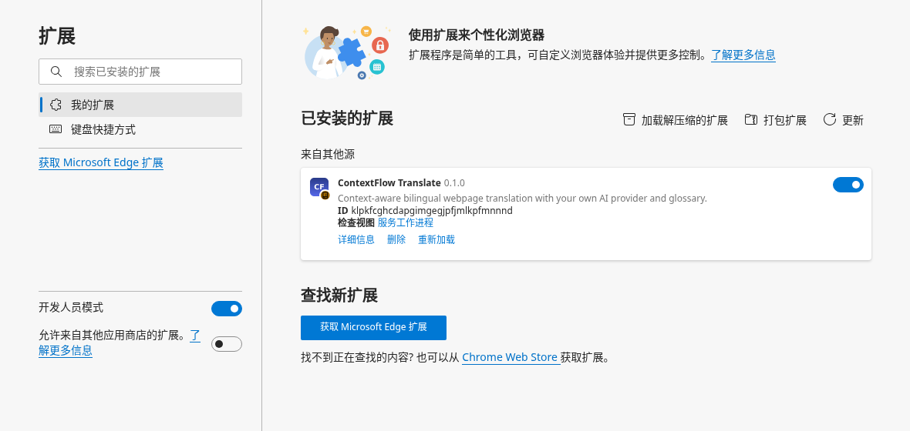
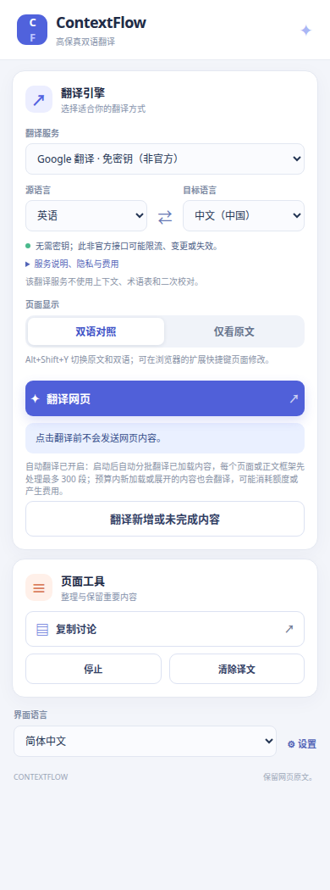
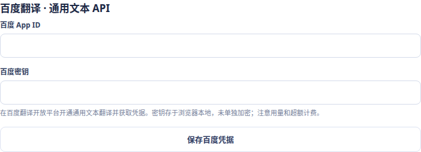

# ContextFlow Translate 图文使用教程

ContextFlow 是一个 Chrome / Edge 双语网页翻译扩展。它可以在原文下方显示译文，也可以复制 Kaggle 讨论和回复。

> 本教程的扩展管理页、翻译面板和设置页截图来自独立浏览器配置中运行的当前扩展；页面上的选项为演示配置。双语阅读示例使用本地预设译文，**不代表某个翻译服务的实际质量**。不同浏览器版本的按钮位置可能略有差异。

## 1. 下载并安装

1. 打开 [ContextFlow Translate GitHub 仓库](https://github.com/muran169633/contextflow-translate)，点击 **Code → Download ZIP**。
2. 解压 ZIP 到一个长期保留的文件夹。确认选中的文件夹内直接包含 `manifest.json`、`popup.html` 等文件；不要选 ZIP 文件，也不要选它的上一级目录。
3. Edge 地址栏输入 `edge://extensions`；Chrome 输入 `chrome://extensions`。
4. 开启**开发人员模式**，点击**加载解压缩的扩展**，选择上一步包含 `manifest.json` 的文件夹。
5. 确认扩展卡片处于启用状态。可以在浏览器右上角的扩展菜单中将 ContextFlow 固定到工具栏。



如果熟悉 Git，也可以在终端克隆仓库，再在浏览器中选择克隆出的目录：

```bash
git clone https://github.com/muran169633/contextflow-translate.git
```

**更新扩展：**通过 Git 克隆的目录可以进入目录执行 `git pull --ff-only`；通过 ZIP 下载的用户需要将新版本文件放到浏览器正在加载的扩展目录中。然后在扩展管理页点击 ContextFlow 卡片上的**重新加载**，并刷新已打开的网页。浏览器的扩展设置仍以当前用户配置为准；不要把下载文件夹误当作扩展根目录。

## 2. 第一次翻译网页

1. 打开一篇普通的 HTTP 或 HTTPS 网页，例如一篇英文文章。
2. 点击浏览器工具栏里的 **ContextFlow** 图标，打开扩展面板。
3. 在**翻译服务**中选择 `Google 翻译 · 免密钥（非官方）`。
4. 将**源语言**设为“英语”，**目标语言**设为“中文（中国）”，点击**翻译网页**。
5. 如果浏览器弹出访问所选翻译服务的权限请求，允许后等待网页显示进度和译文。



上图是展示完整面板的截图；浏览器弹窗高度较小时，可能需要在面板内向下滚动才能看到页面工具和设置。

Google 免密钥模式使用非官方网页接口，**不需要填写模型或 API 密钥**，但可能因网络、限流或接口变化而失效。译文质量由所选服务决定。选择“自动检测”可处理不确定的源语言，但短句可能识别不准，Google 免密钥模式也可能更慢。

翻译后的文字通常出现在对应原文下方。可以点击单段译文旁的**重试**，或在面板中切换**双语对照 / 仅看原文**。下面是布局演示，译文为预设示例：


## 3. 免费服务怎么选

| 扩展里的服务 | 使用条件 | 适用说明 |
| --- | --- | --- |
| Google 翻译 · 免密钥（非官方） | 无需账号或密钥 | 上手方便；可用性和限流没有保证。 |
| MyMemory · 免费 | 无需账号或密钥 | 匿名使用有[每日免费用量限制](https://mymemory.translated.net/doc/usagelimits.php)，需要明确选择源语言。 |
| 百度翻译 · 通用文本 API | 需要百度 App ID 和密钥 | 提供免费额度，超过后可能收费；以[百度定价](https://fanyi-api.baidu.com/product/112)和账户为准。 |
| 微软翻译 · Azure | 需要 Azure Translator 密钥 | F0 有免费额度，其他套餐可能收费；以[微软定价](https://azure.microsoft.com/en-us/pricing/details/cognitive-services/translator/)和账户为准。 |
| LibreTranslate · 本机免费 | 自己安装并运行本机服务及语言模型 | 无需密钥，但不是开箱即用的在线服务；参见 [LibreTranslate 文档](https://docs.libretranslate.com/)。 |

有道智云、Google Cloud 和自选 AI 模型也可在相应设置中配置；试用额度、是否收费和支持的语种以服务商与账户规则为准。**免费不等于无限量**：网页内容会发送给你选择的服务，翻译前请先确认是否适合发送这些内容。

### 配置百度翻译

1. 登录[百度翻译开放平台](https://fanyi-api.baidu.com/)，开通**通用文本翻译 API**，获取 App ID 和密钥。
2. 在 ContextFlow 面板底部点击**设置**，找到**百度翻译 · 通用文本 API**。
3. 分别填写 App ID 和百度密钥，点击**保存百度凭据**。截图展示的是空字段，不包含真实凭据。
4. 返回网页，重新打开 ContextFlow 面板，选择**百度翻译 · 通用文本 API**，选择语言并点击翻译；首次使用时允许访问百度服务域名。



密钥保存在浏览器本地，**没有使用单独的应用密码加密**。请使用你愿意提供给扩展的凭据，并在服务商控制台关注用量和费用。百度的部分语种需要更高版本的账户；扩展不会在失败时自动切换其他服务。

## 4. 翻译长网页和 Kaggle Notebook

点击翻译后，扩展先处理当前视野，然后自动分批处理已加载的正文；初次每个页面或正文框架最多处理 **300 个内容块**。每批默认 50 段，可在**设置 → 每批最多翻译段落数**调整，最大 150。自动分批可能使用更多额度；点击**停止**可阻止继续安排新的批次，已发送的请求仍可能产生用量或费用。

如果达到初次处理上限，点击面板里的**翻译新增或未完成内容**继续。尚未加载、被折叠或页面结构无法识别的文字不保证被翻译；可以先展开、等待加载，再继续翻译。开启自动翻译后，新加载的内容会在本次 300 段预算未满时处理；后续新出现的可见内容也可能触发请求。

Kaggle Notebook 的正文通常在独立框架中。首次在 Notebook 使用时，请在点击**翻译网页**后允许扩展请求的 `kaggleusercontent.com` 和浏览器导航权限。浏览器可能把导航权限描述为“读取浏览历史记录”；扩展使用它查询当前 Notebook 的正文框架。若提示正文未连接，等待 Notebook 加载后再点击翻译。代码块和纯数字默认不翻译。

## 5. 快捷按钮和快捷键

打开扩展面板后，网页右上角会出现**快捷翻译**按钮；点击开始翻译，按住按钮本身即可拖动。点击 `×` 可在当前页面隐藏，重新打开扩展面板可再次显示。

- **Ctrl + Shift + Y**：快捷翻译当前页；macOS 默认为 **Command + Shift + Y**。
- **Alt + Shift + Y**：切换双语和仅看原文；macOS 为 **Option + Shift + Y**。
- 如果快捷键冲突，可在 `edge://extensions/shortcuts` 或 `chrome://extensions/shortcuts` 中修改。第一次使用某个服务或 Kaggle Notebook 时，先在扩展面板点击翻译并完成所需授权。

## 6. 复制 Kaggle 讨论

进入 Kaggle 的**具体讨论主题页面**，打开扩展面板，点击**复制讨论**，然后粘贴到需要的位置。格式示例：

```text
作者：
主题内容

回复者 回复 作者：
回复内容
```

扩展通过当前 Kaggle 页面可访问的接口读取主题和回复，包含接口返回的折叠回复；如果接口返回不完整会提示。复制的是接口里的原文，不包含页面上额外插入的译文。其他网站仅在页面提供可识别的结构化评论时支持复制，未加载回复可能缺失。

## 7. 常见问题

**出现 `Only permissions specified in the manifest may be requested`**

打开 `edge://extensions` 或 `chrome://extensions`，重新加载 ContextFlow，然后刷新原网页。仍有问题时，检查浏览器加载的是否是包含最新版 `manifest.json` 的扩展目录。

**翻译没有反应，或提示后台 / 页面版本不一致**

确认扩展已启用；先重新加载扩展，再刷新网页。首次使用某个服务时从面板点击**翻译网页**并完成授权，而不是直接使用快捷键。浏览器内部页面、商店页面和浏览器自带 PDF 查看器不属于普通网页，不能按普通网页方式翻译。

**提示 429、连接失败或额度不足**

429 通常表示请求受到频率限制；可以稍后重试，或手动选择其他已配置的服务。检查网络、所选服务的权限、账号密钥和剩余额度。Google 免密钥接口是非官方接口，不保证始终可用。请不要反复点击重试以免额外消耗额度。

**页面有内容未翻译**

等待页面和 Notebook 正文加载，检查是否出现框架权限提示；展开折叠内容，再点击**翻译新增或未完成内容**。超过初次 300 块上限的内容需要继续处理。页面布局、代码、纯数字、未加载或被隐藏的内容可能不会作为正文翻译。

**修改语言或服务后译文没变化**

在面板中重新点击**翻译网页**开始新一轮翻译；已有任务及其重试沿用启动时的服务和语言。可使用**清除译文**移除当前页面译文。

**译文不准确**

对照原文，尝试不同服务，并在源语言明确时手动选择语言。技术术语、公式和代码尤其需要人工核对；Google 免密钥与其他普通机器翻译服务不使用 AI 术语表或二次校对。
